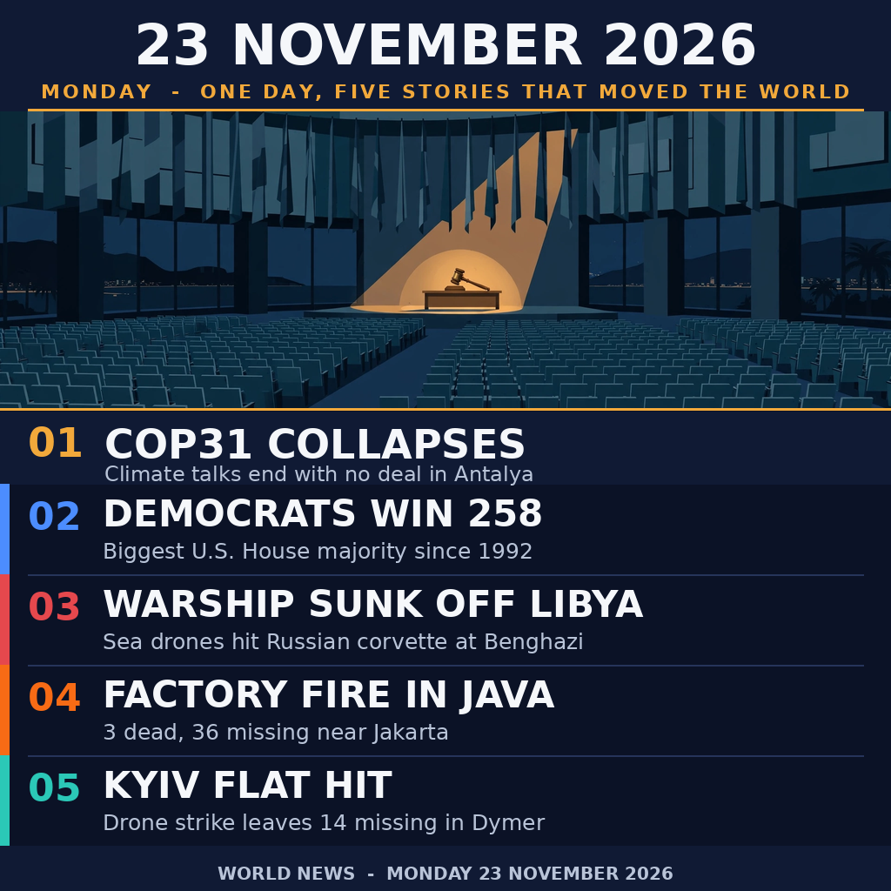

# One Day, Five Stories — Monday 23 November 2026

[](https://make.fun/bounty/news-image-20261123)
[](https://make.fun/bounty/news-image-20261123)
[](https://make.fun/bounty/news-image-20261123)

A single image that sums up the world's news of **Monday 23 November 2026** —
built for the make.fun competition
[news-image-20261123](https://make.fun/bounty/news-image-20261123)
("Sum up 23 November's world news in one image").



## The image

A dark "night desk" poster, not a newspaper page: one date shouted across the
top, one big picture, five stories in five numbered strips. Everything is set
in large type so the whole day still reads at 300 pixels across.

- **Masthead — 23 NOVEMBER 2026.** The date is the biggest thing on the page:
  this is one day, and the image says which one.
- **Hero — COP31 collapses.** An empty summit hall in Antalya at night: rows
  of empty chairs, a fallen gavel caught in a single amber spotlight. The
  climate talks ended with no deal — the longest COP on record, suspended
  after the final text dropped any mention of fossil fuels.
- **02 — Democrats win 258.** The biggest U.S. House majority for either party
  since 1992, setting up divided government.
- **03 — Warship sunk off Libya.** Sea drones hit the Russian corvette
  Merkury at Benghazi; the ship capsized and sank.
- **04 — Factory fire in Java.** A confectionery factory fire near Jakarta:
  3 dead, 36 missing.
- **05 — Kyiv flat hit.** A drone strike on an apartment block in Dymer,
  Kyiv region: 14 missing.

Five stories, five regions, five fields — climate, politics, war at sea, a
disaster at home, a strike on civilians. Nothing invented, nothing hyped:
every line is what was reported that day.

## Why this image wins

1. **It names its day.** 23 November 2026, in the largest type on the page.
2. **It reads at a glance.** One hero image, five short headlines, one line
   each — a viewer who missed the day can tell what happened from the image
   alone.
3. **It is faithful.** The numbers are the reported numbers (258 seats, 3
   dead and 36 missing, 14 missing); the COP31 collapse is shown as an empty
   hall, not a invented scene of chaos.
4. **It is clean.** Dark ground, amber accents, no smears, no garbled text —
   every word is set type, not rendered by a generator.

## How it was built

- The hero illustration (empty summit hall, fallen gavel) was generated as a
  text-free image, then composed with the masthead, strips and footer in a
  Python/PIL layout script — all wording is crisp set type.
- `main.ts` (Node 22, standard library only) validates `entry.png` — PNG
  signature, IHDR size, colour type, IEND, at most 1024×1024 and 1 MiB —
  then copies it byte for byte to `$MAKEFUN_OUTPUT_DIR/entry.png` and
  verifies the copy by sha256. It runs twice and writes identical bytes.

## Run it

```sh
mkdir -p out && MAKEFUN_OUTPUT_DIR=out node main.ts
# writes out/entry.png, 1024x1024 PNG, 388,978 bytes
```

## License

MIT — see [LICENSE](LICENSE).
